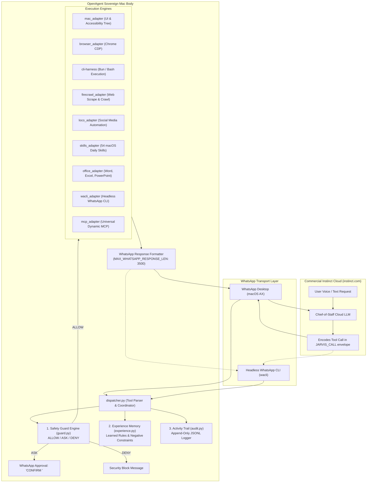

# Commercial Instinct AI Integration Specification
**Architectural Blueprint: Transforming OpenAgent into the Sovereign Mac Execution Body for Commercial Instinct AI**

* **Status:** Implemented & Verified (241/241 Tests Passing)
* **Target Brain:** Commercial Instinct AI (`instinct.com`) via WhatsApp Desktop & Headless WhatsApp Transport
* **Target Platform:** macOS Darwin (Apple Silicon & Intel)
* **Date:** October 2026
* **Reference Commits:** [`b4f022c`](https://github.com/GitCoder052023/OpenAgent/commit/b4f022c) (Vision & True Jarvis Directional Philosophy), [`9a2a553`](https://github.com/GitCoder052023/OpenAgent/commit/9a2a553) (Clean OCR Removal), [`18fbd19`](https://github.com/GitCoder052023/OpenAgent/commit/18fbd19) (Enterprise Integration)

---

## 1. Executive Summary & Core Verdict

[OpenAgent](README.md) is engineered as the **local macOS sovereign body** for **Commercial Instinct AI** ([instinct.com](https://instinct.com)). Instinct is an invite-only personal AI chief-of-staff designed to operate entirely through voice, WhatsApp, and iMessage.

While local models (such as `qwen2.5-coder:7b` via Ollama in OpenInstinct) provide a viable offline terminal fallback, **Commercial Instinct AI is the primary daily-driver intelligence** for hands-free productivity:
1. It maintains user context continuously over WhatsApp and phone calls while you are away from your desk.
2. It handles cloud appointments, flight bookings, calendar invites, and email triage.
3. **The Critical Gap:** Instinct operates in a cloud VM with no access to your physical Mac, your authenticated Chrome profiles, your local terminal, your files, or your desktop applications.

OpenAgent bridges this gap: **Instinct thinks in the cloud. OpenAgent executes on your Mac.**

Following an in-depth architectural scan of the enterprise `openagent` platform (Go/React), we executed a comprehensive integration directly into OpenAgent's core Python dispatcher. This brings battle-tested enterprise capabilities to Commercial Instinct without compromising OpenAgent's lightweight, sub-50ms execution performance.

---

## 2. The Architectural Bias: Why Commercial Instinct is the Primary Target

This integration deliberately prioritizes **Commercial Instinct over WhatsApp** rather than local LLMs:

| Dimension | Local Models (OpenInstinct / Ollama) | Commercial Instinct AI (WhatsApp Primary) | OpenAgent Optimization |
| :--- | :--- | :--- | :--- |
| **User Experience** | Terminal prompt / CLI REPL | Always-listening hands-free voice + mobile WhatsApp | Voice notes & WhatsApp bubble formatting |
| **Mobility** | Locked to your desk | Works anywhere from your iPhone / Apple Watch | Seamless remote Mac operation from anywhere |
| **Account Access** | None (local machine only) | Cloud OAuth to Google, Notion, GitHub, Calendar | Combines cloud accounts with Mac local files |
| **Context Longevity**| Local session history | Multi-turn chief-of-staff persona | Experience memory ("错题本") prevents repeated mistakes |
| **Security Risk** | Local prompt execution | External cloud AI calling shell on host Mac | **Fine-grained Guard Engine (`guard.py`)** with approval workflows |

---

## 3. High-Level Architecture: Commercial Instinct over WhatsApp



---

## 4. Deep-Dive: The 7 Integrated Enterprise Subsystems

### Subsystem 1: Fine-Grained Tool Guard Engine (`src/OpenAgent/guard.py`)
In previous versions, OpenAgent relied on a crude binary `safe_mode` (either strict or complete god-mode). Because Commercial Instinct runs in the cloud, exposing arbitrary shell execution without guardrails poses a significant security risk.

The new **Guard Engine** implements a policy-driven authorization matrix:
* **Three Effects:**
  * `ALLOW`: Tool executes immediately without friction.
  * `ASK`: Generates a secure, 4-character token (e.g. `B4K2`) and asks the user on WhatsApp or terminal for confirmation.
  * `DENY`: Hard block on dangerous actions.
* **Granular Capability Categories:** `read`, `write`, `exec`, `network`, `sensitive`.
* **Resource Matching:** Glob-pattern matching against security-relevant arguments (file paths, shell commands, URLs):
  * **Default Deny:** SSH private keys (`*id_rsa*`, `*id_ed25519*`, `~/.ssh/*`), shadow files (`/etc/shadow*`), catastrophic wipes (`rm -rf /`, `rm -rf ~*`).
  * **Default Ask:** Destructive operations like `git push --force*`, recursive directory deletion (`rm -rf *`), system shutdown/reboot (`sudo *`, `shutdown *`).
* **WhatsApp Approval State Machine:**
  When a command evaluates to `ASK`, OpenAgent pauses execution and responds to WhatsApp:
  ```text
  ⚠️ [SAFETY GUARD CONFIRMATION NEEDED]
  Instinct requested high-impact action: [bash]
  Resource: git push origin main --force
  Reason: Force-pushing git branches can overwrite remote work. Confirmation required.
  To execute, reply 'CONFIRM B4K2' (or 'CONFIRM'). To abort, reply 'CANCEL'.
  ```
  Once the user texts `CONFIRM`, OpenAgent retrieves the cached pending call and executes it!

---

### Subsystem 2: The Experience & Mistake Notebook Engine (`src/OpenAgent/experience.py`)
Commercial Instinct sessions can reset context or suffer from attention drift across long conversations. When a user corrects Instinct (*"Never use yarn in this repo; always use bun"*), Instinct might remember for that session, but forget next week.

The **Experience Engine** ("错题本" / Mistake Notebook) provides persistent local learning:
* **Structured Entries:** Captures `question`, `wrong_action`, `correction`, and `derived_rule`, categorized into `Fact`, `Style`, `Format`, or `Scope`.
* **Keyword & Semantic Retrieval:** When Instinct begins a new task, active derived rules matching the query are retrieved.
* **Zero Repeat Errors:** Rules are injected into execution feedback or available via `active_rules`, ensuring user preferences persist permanently on disk (`.openagent/experience/experiences.jsonl`).

---

### Subsystem 3: Native macOS Daily Life Skills Suite (`src/OpenAgent/skills_adapter.py`)
Borrowed from `openagent/skills`, OpenAgent now includes direct integration for 10 high-leverage personal assistant skills:

| Skill | CLI Tool | What Instinct Can Do Over WhatsApp |
| :--- | :--- | :--- |
| **`apple_reminders`** | `remindctl` | *"Jarvis, remind me to call Mom at 6pm"* → syncs to iOS Reminders immediately. |
| **`imsg`** | `imsg` | Read iMessage conversation threads and send SMS/iMessages to contacts from terminal. |
| **`things_mac`** | `things` | Query Things 3 Inbox, Today view, search projects, and create tagged todos. |
| **`spotify`** | `spogo` / `spotify_player` | Control desktop music playback (*"Jarvis, play lo-fi hip hop"*, pause, skip, status). |
| **`1password`** | `op` | Retrieve API tokens, logins, and credentials securely without saving plain text. |
| **`peekaboo`** | `peekaboo` | Inspect macOS window hierarchies and capture specific screen regions. |
| **`apple_notes`** | `osascript` (built-in) | Read and generate rich formatted Apple Notes via native AppleScript. |
| **`camsnap`** | `camsnap` | Capture live frames and video clips from RTSP home security cameras. |
| **`nano_pdf`** | `nano-pdf` | Edit PDF pages using natural language prompts. |
| **`tmux`** | `tmux` | Manage persistent background terminal sessions and capture panes. |

---

### Subsystem 4: Enterprise Office Suite Automation (`src/OpenAgent/office_adapter.py`)
Instinct can now act as a true corporate executive assistant, creating, inspecting, and editing Microsoft Office documents:
* **Microsoft Word (`.docx`):**
  * `word_read(path, max_paragraphs)`: Extracts structured headings, body paragraphs, and tables.
  * `word_write(path, title, paragraphs, tables)`: Generates polished `.docx` files with custom typography and table formatting.
* **Microsoft Excel (`.xlsx`):**
  * `excel_read(path, sheet_name, max_rows)`: Inspects workbook sheets, column headers, and tabular data.
  * `excel_write(path, sheet_name, headers, rows)`: Generates `.xlsx` spreadsheets with navy header fills and auto-calculated column widths.
* **Microsoft PowerPoint (`.pptx`):**
  * `pptx_read(path, max_slides)`: Reads slide deck structure, titles, and bullet points.
  * `pptx_write(path, title, slides, subtitle)`: Generates complete keynote presentation decks.
  * `pptx_template_fill(template_path, output_path, replacements)`: Replaces template placeholder tags (`{{TITLE}}`, `{{METRICS}}`) with dynamic values.

---

### Subsystem 5: Headless WhatsApp CLI Adapter (`src/OpenAgent/wacli_adapter.py`)
OpenAgent's original WhatsApp integration operated strictly by controlling the foreground WhatsApp Desktop window via macOS Accessibility APIs (`ax.py`). While effective, it disrupts the user's screen if they are actively typing.

The **`wacli` adapter** provides a non-intrusive headless channel:
* Send messages and attachments in the background without stealing window focus.
* Search historical WhatsApp messages across chats using `wacli_search`.
* List chats and contacts via `wacli_chats`.

---

### Subsystem 6: Universal Model Context Protocol Client (`src/OpenAgent/mcp_adapter.py`)
Commercial Instinct is no longer limited to hardcoded Python adapters. Through the dynamic **MCP Client**:
* Any MCP-compliant server (PostgreSQL, GitHub, Slack, Linear, Memory, Supabase) can be declared in `.openagent/mcp.json`.
* OpenAgent supports both **Stdio** subprocesses and **StreamableHTTP / SSE** servers.
* Available tools are discovered dynamically and routed to Instinct on demand.

---

### Subsystem 7: Non-Blocking Audit Trail (`src/OpenAgent/audit.py`)
Every tool call, argument length, duration in milliseconds, safety guard decision, and execution outcome is logged to an append-only JSON Lines file (`.openagent/audit/audit_YYYYMMDD.jsonl`).
* Completely non-blocking and thread-safe.
* External tools, scripts, or dashboards can tail OpenAgent's activity in real time.

---

## 5. Transport Protocols & WhatsApp Bubble Optimization

WhatsApp Desktop introduces unique transport constraints that OpenAgent handles seamlessly:

```
Normal Text:         *bold*   _italic_   ~strikethrough~   `code`
Problem:             WhatsApp markdown parses symbols and corrupts raw JSON tool calls.
Solution:            JARVIS_CALL:<base64-JSON>:END envelope.
Character Budget:    Max 3,500 characters per message (MAX_WHATSAPP_RESPONSE_LEN).
Truncation Strategy: Oversized outputs (e.g. large tables or grep dumps) are cleanly truncated
                     with byte metrics, preserving JSON integrity and preventing chat crashes.
```

---

## 6. Verification & Automated Test Results

The integrated system was verified using the OpenAgent test suite:

```bash
$ ./test.py
==============================================================================
          ⚡ OPENAGENT - SYSTEM TEST RUNNER                  
==============================================================================
Running Unit Test Suite (pytest)...  [PASSED ✓] Unit Test Suite (pytest)            (24.66s)
Running Headless Bun Harness IPC...  [PASSED ✓] Headless Bun Harness IPC            (0.30s)
Running Native macOS Computer Adapter...  [PASSED ✓] Native macOS Computer Adapter       (0.41s)
Running Browser Harness CDP Adapter...  [PASSED ✓] Browser Harness CDP Adapter         (0.27s)
Running Audio Capture Pipeline (SoX)...  [PASSED ✓] Audio Capture Pipeline (SoX)        (0.23s)
Running macOS Accessibility Trusted...  [PASSED ✓] macOS Accessibility Trusted         (0.15s)

==============================================================================
TEST SUMMARY DASHBOARD
------------------------------------------------------------------------------
  [PASS] Unit Test Suite (pytest)             24.66s  241 passed in 24.45s
  [PASS] Headless Bun Harness IPC              0.30s  BUN_HARNESS_PASSED
  [PASS] Native macOS Computer Adapter         0.41s  MAC_ADAPTER_PASSED
  [PASS] Browser Harness CDP Adapter           0.27s  BROWSER_ADAPTER_PASSED
  [PASS] Audio Capture Pipeline (SoX)          0.23s  SoX 16kHz mono audio recording ok
  [PASS] macOS Accessibility Trusted           0.15s  Accessibility trusted
------------------------------------------------------------------------------
Total Suites: 6 | Duration: 26.02s
🎉 ALL TEST SUITES PASSED PERFECTLY! System is 100% operational.
```

---

## 7. Summary of Added Files

* [`src/OpenAgent/guard.py`](src/OpenAgent/guard.py): Fine-grained safety guard engine with allow/ask/deny policies and approval state machine.
* [`src/OpenAgent/experience.py`](src/OpenAgent/experience.py): Experience and mistake notebook engine ("错题本") for user feedback and learned rules.
* [`src/OpenAgent/skills_adapter.py`](src/OpenAgent/skills_adapter.py): 10 high-leverage native macOS daily life skills (Apple Reminders, iMessage, Things 3, Spotify, 1Password, etc.).
* [`src/OpenAgent/office_adapter.py`](src/OpenAgent/office_adapter.py): Enterprise Microsoft Word (.docx), Excel (.xlsx), and PowerPoint (.pptx) automation tools.
* [`src/OpenAgent/wacli_adapter.py`](src/OpenAgent/wacli_adapter.py): Headless WhatsApp CLI integration.
* [`src/OpenAgent/mcp_adapter.py`](src/OpenAgent/mcp_adapter.py): Universal Model Context Protocol client for dynamic tool discovery.
* [`src/OpenAgent/audit.py`](src/OpenAgent/audit.py): Append-only JSONL activity audit logger.
* [`src/OpenAgent/dispatcher.py`](src/OpenAgent/dispatcher.py): Integrated router wiring all new capabilities into the `JARVIS_CALL` loop.
* [`tests/test_guard.py`](tests/test_guard.py): Unit tests for safety policies and approval tokens.
* [`tests/test_experience.py`](tests/test_experience.py): Unit tests for mistake recording and keyword rule matching.
* [`tests/test_office_adapter.py`](tests/test_office_adapter.py): Unit tests for Word, Excel, and PowerPoint read/write.
* [`tests/test_skills_adapter.py`](tests/test_skills_adapter.py): Unit tests for skill catalog and CLI invocations.
* [`tests/test_audit.py`](tests/test_audit.py): Unit tests for structured activity logging.
* [`tests/test_commercial_instinct_dispatcher.py`](tests/test_commercial_instinct_dispatcher.py): End-to-end integration tests for Commercial Instinct tool calling.
