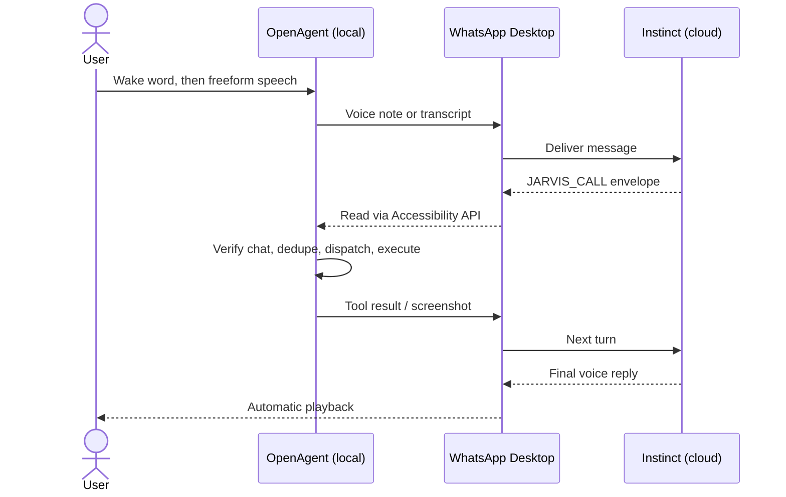

https://github.com/user-attachments/assets/90830bd1-722e-4088-91be-932a40948b18

<div align="center">

# OpenAgent ⌘

**Say "Wake up, Jarvis." Then just talk.**<br/>
OpenAgent is an integrated, local macOS execution environment providing **85+ callable tools** that allow [Instinct AI](https://instinct.com/) to operate your Mac, your browser, social media, WhatsApp, and digital workflows on your behalf—an always-listening, hands-free assistant while you get on with your day.

[](https://www.apple.com/macos/)
[](LICENSE)
[]()

[Quick Start](#quick-start) · [Talking to Jarvis](#talking-to-jarvis) · [Why OpenAgent](#why-openagent) · [How It Works](#how-it-works) · [Core Features](#core-features) · [Tool Suite](#tool-suite) · [Philosophy](#-directional-philosophy-the-true-jarvis-vision) · [Docs](#documentation) · [Contributing](#contributing)

</div>

---

OpenAgent connects [Instinct AI](https://instinct.com/), a personal AI assistant that lives in your messaging apps, to your Mac and gives it a voice interface modeled on Jarvis. Start it once and say **"Wake up, Jarvis."** From then on, you speak naturally from anywhere in the room, and Instinct AI reasons over each request while OpenAgent carries it out locally through **85+ callable tools**: shell commands, code edits, native app control, your authenticated Chrome, self-hosted web scraping, office documents, native macOS productivity apps, social media automation, and WhatsApp actions on your behalf.

The two halves together make up a personal assistant that can act in the cloud and on your desktop: **Instinct thinks. OpenAgent acts.**

Don't have Instinct access, or want to use your own model? [OpenHarness](https://github.com/GitCoder052023/OpenHarness) is the execution engine behind OpenAgent, available on its own. Connect Claude, Gemini, Codex, or a local Ollama model to the same Mac tools without the voice and WhatsApp setup.

```text
[ Jarvis sleeping ]

You (making coffee):  "Wake up, Jarvis."
[ Jarvis awake ]

You:       "Run the test suite on OpenAgent. If it's green, post a Threads update
            about what I shipped today."
             bash               ./test.py                              260 passed
             bash               git log --since=midnight --oneline     6 commits
             social_dedup_check threads / post                         not yet posted
             social_post        threads.net (authenticated profile)    published
Jarvis:    "All 260 tests passed. The update is live on Threads."

You (from the couch):  "Show me what it looks like."
             social_screenshot  live Chrome session                    delivered to WhatsApp
Jarvis:    "Screenshot's in your chat."

You:       "Jarvis, stand by."  →  "Confirm stand by, Jarvis."
[ Jarvis sleeping ]
```

## Talking to Jarvis

OpenAgent is built around **continuous, hands-free conversation**: the way Tony Stark talks to Jarvis while he's working, making coffee or watching TV.

- **Wake once, keep talking.** Say *"Wake up, Jarvis"* (or *"Hey Jarvis"*) and the session stays awake. Speak naturally, pause, and the request is sent after a stretch of silence.
- **Natural turn-taking.** Instinct's voice replies play automatically through your speakers. 
- **Freeform follow-ups.** The conversation lives in your Instinct chat, so context carries across turns. *"Now do the same for Reddit"* or *"Make it shorter"* works the way you'd expect.
- **Private by default.** Wake-word detection (Vosk) runs fully offline, and idle audio is never saved or sent. Nothing leaves your Mac until Jarvis is awake and you've spoken a request.
- **Push-to-talk fallback.** For quiet environments or shared spaces, hold `F8` to talk instead.

## Why OpenAgent

[Instinct](https://instinct.com/) is an invite-only personal AI assistant that works entirely through iMessage and WhatsApp. It has no app and no dashboard: you text it, send a voice note or call it. Instinct works as a chief of staff rather than a chatbot. It books appointments, manages travel, disputes bills, cancels subscriptions and reaches out on its own to follow up on deadlines. It connects to services like GitHub, Google and Notion, and it handles general computer work on virtual desktops in its own cloud.

Because that computer use happens in Instinct's cloud environment, it can reach your **accounts** but not your **machine**. OpenAgent closes that gap:

| Capability | Instinct | Instinct + OpenAgent |
| :--- | :---: | :---: |
| Always-listening, hands-free voice sessions at your desk | — | ✓ |
| Account-level tasks (email, calendar, GitHub, Notion) | ✓ | ✓ |
| Proactive reminders and follow-ups | ✓ | ✓ |
| Shell execution and code edits on your local machine | — | ✓ |
| Seeing your screen and controlling native macOS apps | — | ✓ |
| Driving your authenticated, everyday Chrome profile | — | ✓ |
| Operating WhatsApp Desktop | — | ✓ |
| Posting and engaging on Threads, Reddit, X, LinkedIn and more from your own browser sessions | — | ✓ |
| Private, self-hosted web scraping and crawling | — | ✓ |

<div align="center">
  <strong>Instinct thinks. OpenAgent acts.</strong><br/>
</div>

## How It Works

OpenAgent uses **WhatsApp Desktop as the transport** between Instinct and your Mac. You don't need an API key, a hosted backend or a custom integration.

1. **Input.** Once woken with *"Wake up, Jarvis"*, OpenAgent listens continuously to your speech until a natural pause, and then sends either a voice note or a local Whisper transcript to your Instinct chat.
2. **Tool calls.** Instinct replies with structured calls wrapped in a `JARVIS_CALL:<base64-JSON>:END` envelope. Base64 encoding protects the payload from WhatsApp's markdown formatting, which removes characters like `*`, `_` and `~`.
3. **Observation.** OpenAgent reads incoming messages through the macOS Accessibility API.
4. **Verification.** A fail-closed guard confirms the message came from the verified Instinct chat.
5. **Execution.** The dispatcher routes the call to the appropriate engine or adapter and runs it locally.
6. **Response.** Results, diffs and screenshots go back into the chat. Instinct continues the loop until the task is complete, and its voice replies play back automatically.



## Core Features

| Capability / Engine | What it provides | Built on |
| :--- | :--- | :--- |
| **Developer Harness** | Sandboxed `bash`, paginated `read`, atomic `write`, exact-match `edit`, `ripgrep` regex search, `glob`, and AppleScript | Bun + TypeScript |
| **Voice Interface** | Offline wake word, continuous hands-free sessions, silence-based turn-taking, echo guard, automatic reply playback | Vosk, whisper.cpp, SoX |
| **Native Computer Use** | Window capture, Accessibility tree queries, PID-targeted clicks, keystrokes, drags and scrolls that don't steal focus | macOS Accessibility & Quartz |
| **Browser Automation** | Authenticated Chrome: background tabs, compositor clicks through iframes and shadow DOM, framework-safe form filling, 97 domain-specific skills | Browser Harness (CDP) |
| **Web Ingestion & Search** | Scrape to clean Markdown, search with full-content results, recursive crawl, site mapping, schema-based JSON extraction | Self-hosted Firecrawl (Docker) |
| **Social Media Automation** | Posting, replies, likes, search and scheduled workflows on Threads and Reddit (plus X, LinkedIn, Instagram, Facebook, YouTube, TikTok, GitHub) in isolated, persistent Chrome profiles | LocoAgent (CDP) |
| **macOS Productivity** | Native desktop integrations: Apple Reminders, iMessage, Things 3, Spotify, 1Password, Apple Notes, camera feeds, Nano-PDF, Tmux | `skills_adapter.py` (CLI Suite) |
| **Office Document Automation** | Standalone Microsoft Word (`.docx`), Excel (`.xlsx`), and PowerPoint (`.pptx`) generation, inspection, and template filling without requiring Microsoft Office | `office_adapter.py` (`python-docx`, `openpyxl`, `python-pptx`) |
| **WhatsApp Communication** | Full multi-device headless WhatsApp operations (chats, messages, voice notes, media, polls, contacts) plus lightweight `wacli` CLI fallback | `whatsapp-mcp-extended` (Go `whatsmeow` + MCP), `wacli` |
| **Universal MCP Client** | Dynamic discovery and execution of external tools from any MCP server across Stdio subprocesses and remote SSE/StreamableHTTP endpoints | `mcp_adapter.py` (Model Context Protocol) |
| **Zero-Focus Ghost Mode** | Pure background execution while you game or work: CDP offscreen perception, AX tree queries, PID input targeting, and instant focus restoration | `browser_adapter`, `mac_adapter`, `desktop` |

### 👻 Zero-Focus Background Operation (Ghost Mode)
You can play immersive fullscreen games (Metal, Steam, Wine/CrossOver) or work in your editor with exclusive mouse capture and keyboard focus while Jarvis works in the background:
- **Offscreen Web & Social Media**: Jarvis opens tabs, reads feeds, posts updates, upvotes, and comments via Chrome DevTools Protocol (CDP) without ever raising a window or moving your physical cursor.
- **Background Vision & Perception**: Captures screenshots using offscreen compositor buffers and `/usr/sbin/screencapture -l <window_id>` without bringing background windows forward.
- **Background Accessibility Tree**: Queries full Accessibility trees (`browser_ax` and `mac_ax`) offscreen without activation.
- **Silent Music Playback**: Controls Spotify and Apple Music playback via native Apple Events and CLI daemons without focus loss.
- **Fail-Safe Focus Restoration**: Any background operation captures the user's active application PID and instantly restores focus in milliseconds.

**Self-healing runtime.** `boot.py` provisions its own environment, installs missing dependencies, downloads speech models, restarts the agent (and its listening session) with exponential backoff and keeps WhatsApp Desktop alive in the background. `./boot.py --doctor` runs a full preflight audit.

## Quick Start

### Prerequisites

* macOS 14 (Sonoma) or macOS 15 (Sequoia) on Apple Silicon or Intel
* [uv](https://astral.sh/uv) (Astral Python package and project manager)
* [Homebrew](https://brew.sh/) & [Bun](https://bun.sh/)
* Official **WhatsApp Desktop** installed and logged in

### 1. One-Command Autonomous Python Scripts

OpenAgent includes dedicated, single-command Python scripts for all lifecycle tasks:

| Script | Purpose | Common Command |
| :--- | :--- | :--- |
| **[`boot.py`](boot.py)** | **Autonomous Boot & Watchdog** | `./boot.py` (or `python3 boot.py`) |
| **[`install.py`](install.py)** | **Full Zero-Touch Installation** | `./install.py` (or `python3 install.py`) |
| **[`calibrate.py`](calibrate.py)** | **WhatsApp UI Auto-Calibration** | `./calibrate.py --save` |
| **[`test.py`](test.py)** | **Comprehensive Test Runner** | `./test.py` |

#### Quick Start:
```bash
git clone https://github.com/GitCoder052023/OpenAgent.git
cd OpenAgent

# 1. Full system installation (homebrew tools, venv, bun harness, speech models)
./install.py

# 2. Calibrate WhatsApp Desktop UI paths and labels (auto-detected)
./calibrate.py --save

# 3. Verify entire system with test suite
./test.py

# 4. Launch Jarvis with hands-free wake word enabled
./boot.py --voice --send-mode audio
```

`boot.py` is an autonomous, self-bootstrapping orchestrator and supervisor:
* **Self-Bootstrapping**: Auto-detects runtime, provisions/syncs virtual environment with `uv`, and re-execs inside `.venv` without manual activation.
* **Auto-Healing Dependencies**: Auto-resolves and installs Homebrew tools (`uv`, `bun`, `sox`, `ffmpeg`, `ripgrep`, `whisper-cpp`) and Bun harness modules.
* **Model Provisioning**: Automatically downloads offline speech models (Whisper ggml & Vosk wake models).
* **Self-Healing Supervisor Watchdog**: Supervises the agent process, re-starts OpenAgent on crashes with exponential backoff, and keeps WhatsApp Desktop backgrounded and alive.
* **Interactive Diagnostics**: Run `./boot.py --doctor` to conduct a zero-touch preflight audit of all hardware, harnesses, and permissions.

```bash
# Common launch commands:
./boot.py --voice --send-mode audio  # Recommended: hands-free wake word ("Wake up Jarvis")
./boot.py                           # Push-to-talk mode (hold F8 to speak)
./boot.py --doctor                  # Run preflight health check without starting agent
./boot.py --voice --send-mode text  # Wake-word mode with local Whisper STT transcription
./boot.py --start-whatsapp-mcp      # Spin up native WhatsApp multi-device bridge & MCP server
./boot.py --start-firecrawl         # Auto-spinup Firecrawl Docker scraper engine
./boot.py --start-chrome            # Auto-launch Chrome with remote debugging on port 9222
./calibrate.py --dump               # Dump sanitized AX UI tree for deep debugging
./test.py --unit                    # Run only unit test suite
./test.py --harness                 # Test live Bun IPC harness
./test.py                           # Comprehensive system test runner
```


### 2. Grant macOS Permissions

Open **System Settings → Privacy & Security** and verify permissions for your terminal application:

* **Accessibility**: UI inspection and desktop automation
* **Input Monitoring**: Global push-to-talk hotkey (`F8`)
* **Microphone**: Audio recording via SoX
* **Screen Recording**: Window capture (`mac_see`)
* **Automation**: System Events and AppleScript app control

### 3. One-Time WhatsApp Setup

OpenAgent uses WhatsApp in two complementary roles:
1. **WhatsApp Desktop**: The conversational voice and text transport between you, your Mac, and Instinct AI.
2. **Native WhatsApp Protocol Engine (`whatsapp-mcp-extended`)**: The headless multi-device engine that allows Jarvis to send messages, read threads, search history, send files/voice notes, reactions, and polls on your behalf without touching the desktop GUI.

---

#### Part A: WhatsApp Desktop & Instinct AI (The Voice/Chat Interface)

1. **Install WhatsApp Desktop**:
   Download and log into official [WhatsApp Desktop](https://www.whatsapp.com/download) on your Mac.
2. **Configure `.env`**:
   Ensure `BRIDGE_WHATSAPP_NUMBER` matches your Instinct AI agent's phone number (e.g. `+16508702892`):
   ```bash
   BRIDGE_WHATSAPP_NUMBER=+16508702892
   ```
3. **Calibrate UI Elements**:
   Run the calibration script to auto-detect WhatsApp Desktop's accessibility buttons and input fields:
   ```bash
   ./calibrate.py --save
   ```
4. **Send the Initial Setup Prompt to Instinct**:
   - Open [`docs/JARVIS_INSTRUCTIONS.md`](docs/JARVIS_INSTRUCTIONS.md).
     > ⚠️ **Note for Readers:** `docs/JARVIS_INSTRUCTIONS.md` contains the author's persona settings, handles, and accounts. Personalize it with your own name, preferences, and details.
   - Copy the text from `[SYSTEM INSTRUCTION & CAPABILITIES INITIALIZATION]` downwards.
   - Send it directly into your WhatsApp chat with Instinct AI.

Instinct will recognize the `JARVIS_CALL` protocol and begin executing tasks on your Mac!

---

#### Part B: Linking Your Account to the Headless Protocol Engine (`whatsapp-mcp-extended`)

This links your personal WhatsApp account as a companion multi-device session so Jarvis can perform actions for you (e.g., *"Jarvis, message Sarah that I'm running 5 mins late"*, *"Check my unread messages"*, or *"Send this PDF to the dev group"*):

1. **Start the WhatsApp Protocol Engine**:
   ```bash
   ./boot.py --start-whatsapp-mcp
   ```
   This automatically brings up the Go bridge (`http://localhost:8180`) and Web UI (`http://localhost:8090`).

2. **Link via 8-Digit Pairing Code (Recommended — No QR Needed)**:
   - Open **[http://localhost:8090](http://localhost:8090)** in your browser.
   - Enter your phone number in full international format (e.g., `919876543210`, country code first, no `+` or spaces).
   - Click **Generate Code** to receive an 8-character pairing code.
   - On your phone: Open **WhatsApp** → **Settings** (or 3 dots) → **Linked Devices** → **Link a Device**.
   - Tap **Link with phone number instead** at the bottom and enter the 8-character code.

3. **Alternative: Link via Live Terminal QR Code**:
   If you prefer scanning a QR code:
   ```bash
   docker logs -f whatsapp-mcp-whatsapp-bridge-1
   ```
   Point your phone camera from **WhatsApp > Linked Devices > Link a Device** at the terminal ASCII QR.

4. **Verify Session Status**:
   ```bash
   curl -s http://localhost:8180/api/connection
   # Returns: {"success":true,"connected":true,"linked":true,"needs_pairing":false,"jid":"..."}
   ```

> 🔒 **Session Persistence & Recovery:**  
> - **Persistent Sessions:** All credentials and cryptographic keys are saved into `src/tools/whatsapp-mcp/data/whatsapp-bridge.db` and persist automatically across Mac reboots and container restarts. You do not need to re-pair every time you run OpenAgent.  
> - **Pairing Reset:** If a pairing attempt ever times out or is interrupted, simply click reset in the Web UI or run:
>   ```bash
>   curl -s -X POST http://localhost:8180/api/pair/reset
>   ```

## How to Operate

**Jarvis mode (recommended).** Start OpenAgent with continuous listening enabled:

```bash
./boot.py --voice --send-mode audio
```

**Push-to-talk.** Start with `./boot.py` (or `./start.sh`). Hold `F8`, speak, then release to send. Holding `F8` during a reply cuts the reply short. Press `Esc` to cancel or exit.

## Tool Suite

Instinct calls tools by wrapping structured JSON in a transport envelope:
`JARVIS_CALL:<base64-encoded-JSON>:END`.

OpenAgent provides 85+ callable tools across 9 functional categories. Expand a section for the full reference.

<details>
<summary><b>Developer Harness Tools</b> (8 tools)</summary>

| Tool | Description | Key Arguments |
| --- | --- | --- |
| `bash` | Execute shell commands in `zsh` | `command`, `cwd`, `timeout_ms` |
| `read` | Read file contents or list directories with pagination | `path`, `offset`, `limit` |
| `write` | Atomically write or overwrite files | `path`, `content` |
| `edit` | Exact chunk search-and-replace with unified diff output | `path`, `old_string`, `new_string` |
| `grep` | High-speed regex code search via `ripgrep` | `pattern`, `path` |
| `glob` | Find files matching glob patterns | `pattern`, `path` |
| `applescript` | Execute multiline native AppleScript via `osascript` | `script` |
| `system_info` | Inspect local OS version, hardware, and runtime status | *(none)* |

</details>

<details>
<summary><b>Native macOS Computer-Use Tools</b> (10 tools)</summary>

| Tool | Description | Key Arguments |
| --- | --- | --- |
| `mac_see` | Capture window screenshot and extract interactive UI elements | `app`, `send_image`, `include_summary` |
| `mac_click` | PID-targeted mouse click without stealing focus | `x`, `y`, `app`, `button`, `click_count` |
| `mac_type` | Type text directly into a target application | `text`, `app` |
| `mac_key` | Trigger keyboard shortcuts (e.g., `cmd+s`, `enter`) | `key`, `app` |
| `mac_drag` | Perform drag-and-drop operations | `start_x`, `start_y`, `end_x`, `end_y`, `app` |
| `mac_scroll` | Send directional scroll events | `x`, `y`, `dx`, `dy`, `app` |
| `mac_apps` | List all running applications with process IDs | *(none)* |
| `mac_windows` | List open window titles and bounds for an application | `app` |
| `mac_ax` | Query and interact with macOS Accessibility elements | `action`, `app`, `text` |
| `mac_python` | Run compound, multi-step UI workflows locally in Python | `code` |

</details>

<details>
<summary><b>Browser Automation Tools</b> (14 tools)</summary>

| Tool | Description | Key Arguments |
| --- | --- | --- |
| `browser_open` | Navigate or open a new tab in your authenticated Chrome session | `url`, `new_tab` |
| `browser_info` | Inspect page URL, title, viewport dimensions, and scroll offset | *(none)* |
| `browser_click` | Composited CDP mouse click bypassing iframes/shadow DOM | `x`, `y`, `selector`, `button`, `click_count` |
| `browser_fill` | Framework-safe form input (React/Vue synthetic events) | `selector`, `text`, `clear_first`, `timeout` |
| `browser_type` | Type text into currently focused web element | `text` |
| `browser_key` | Trigger web keyboard shortcuts (`Enter`, `Escape`, `Tab`, `Backspace`) | `key`, `modifiers` |
| `browser_scroll` | Scroll by delta pixels or scroll element into view | `dx`, `dy`, `selector` |
| `browser_tabs` | Background tab management (`list`, `new`, `switch`, `close`, `current`) | `action`, `target`, `url` |
| `browser_see` | Inspect tab state and send visual screenshot to WhatsApp | `send_image`, `max_elements` |
| `browser_ax` | Discover buttons/inputs via internal Accessibility Tree | `action`, `text`, `role`, `limit` |
| `browser_eval` | Evaluate JavaScript in the active tab context | `expression` |
| `browser_wait` | Wait for page load, network idle, or element appearance | `for_what`, `selector`, `timeout` |
| `browser_python` | Ultra-fast compound browser burst execution (<200ms) | `code`, `timeout` |
| `domain_skills` | Retrieve pre-built domain automation skills for 80+ platforms | `host` |

</details>

<details>
<summary><b>Web Ingestion & Extraction Tools</b> (7 tools)</summary>

| Tool | Description | Key Arguments |
| --- | --- | --- |
| `firecrawl_scrape` | Scrape dynamic web pages directly into clean LLM Markdown | `url`, `formats`, `only_main_content`, `wait_for` |
| `firecrawl_search` | Search the web and return full Markdown from top hits in one shot | `query`, `limit`, `scrape_options` |
| `firecrawl_crawl` | Asynchronously crawl an entire domain or documentation tree | `url`, `max_depth`, `limit` |
| `firecrawl_status` | Check the progress and page count of an ongoing crawl | `job_id` |
| `firecrawl_map` | Fast sitemap and URL discovery across a domain | `url`, `search`, `limit` |
| `firecrawl_extract` | Extract structured JSON data matching a schema or prompt | `urls`, `prompt`, `schema` |
| `firecrawl_doctor` | Inspect health of self-hosted local Firecrawl daemon | *(none)* |

</details>

<details>
<summary><b>Social Media Automation Tools</b> (13 tools)</summary>

Operate real social accounts with primary focus on **Threads (`threads.net`) and Reddit (`reddit.com`)** (plus X/Twitter, LinkedIn, Instagram, Facebook, YouTube, TikTok, and GitHub) with persistent anti-detection Chrome profiles:

| Tool | Description | Key Arguments |
| --- | --- | --- |
| `social_targets` | Inspect all configured social platforms and live CDP port status | *(none)* |
| `social_setup` | Launch persistent, isolated Chrome browser for a social platform | `target`, `all`, `reset` |
| `social_post` | Publish a post or tweet with optional image/media attachment | `text`, `platform`, `media` |
| `social_reply` | Reply to a post or tweet with anti-deduplication check | `url`, `text`, `platform` |
| `social_like` | Like or react to a post with anti-deduplication check | `url`, `platform` |
| `social_search` | Search social media discussions by keyword/hashtag | `query`, `platform`, `tab` |
| `social_screenshot` | Capture live social feed screenshot delivered to WhatsApp | `platform`, `full`, `annotate` |
| `social_workflow` | Control automation pipelines (`run`, `start`, `stop`, `daemon`, `status`) | `action`, `id`, `interval` |
| `social_agent_task` | Delegate an end-to-end autonomous social media mission | `prompt`, `model`, `timeout` |
| `social_dedup_check` | Check if a URL was already interacted with in persistent ledger | `platform`, `action`, `url` |
| `social_log` | Record a successful interaction into the operation log | `platform`, `action`, `url`, `status`, `note` |
| `social_exec` | Execute direct `agent-browser` CDP command on any target | `platform`, `command` |
| `social_doctor` | Run health checks on Bun, agent-browser CLI, and Chrome CDP | *(none)* |

</details>

<details>
<summary><b>Native macOS Productivity Tools</b> (10 tools)</summary>

Execute native macOS productivity and desktop workflows through system CLIs and AppleScript (`remindctl`, `imsg`, `things`, `spogo`, `op`, `peekaboo`, `osascript`, `camsnap`, `nano-pdf`, `tmux`):

| Tool | Description | Key Arguments |
| --- | --- | --- |
| `apple_reminders` | Create, list, complete, and delete Apple Reminders (synced to iOS via `remindctl`) | `action`, `title`, `due`, `list` |
| `imsg` | Read iMessage conversation threads and send SMS/iMessage from the command line (`imsg`) | `action`, `to`, `text`, `limit` |
| `things_mac` | Query Things 3 Inbox, Today view, search tasks, and add tagged todos (`things`) | `action`, `title`, `notes`, `when` |
| `spotify` | Control desktop Spotify playback, search tracks, and list devices (`spogo`) | `action`, `query` |
| `1password` | Retrieve secrets, API tokens, and logins securely via 1Password CLI (`op`) | `action`, `item`, `reference` |
| `peekaboo` | Inspect macOS window hierarchies and capture specific screen regions (`peekaboo`) | `action`, `target`, `out` |
| `apple_notes` | Create and search rich formatted Apple Notes via native AppleScript (`osascript`) | `action`, `title`, `body` |
| `camsnap` | Capture live frames and video clips from RTSP/ONVIF security cameras (`camsnap`) | `action`, `camera` |
| `nano_pdf` | Edit PDF pages using natural language prompts (`nano-pdf`) | `action`, `path`, `prompt` |
| `skills_list` | List all registered agent skills and local installation status | *(none)* |

</details>

<details>
<summary><b>Office Document Tools</b> (7 tools)</summary>

Inspect, create, and format Microsoft Office documents programmatically without requiring Microsoft Office installed, built on `python-docx`, `openpyxl`, and `python-pptx`:

| Tool | Description | Key Arguments |
| --- | --- | --- |
| `word_read` | Read Word `.docx` documents with headings, body paragraphs, and tables | `path`, `max_paragraphs` |
| `word_write` | Generate styled Word `.docx` documents with custom headings and table styling | `path`, `title`, `paragraphs`, `tables` |
| `excel_read` | Inspect Excel `.xlsx` workbooks, sheet names, headers, and data rows | `path`, `sheet_name`, `max_rows` |
| `excel_write` | Create or update formatted Excel `.xlsx` workbooks with styled headers and column widths | `path`, `sheet_name`, `headers`, `rows` |
| `pptx_read` | Inspect PowerPoint `.pptx` decks, slide hierarchy, titles, and bullet points | `path`, `max_slides` |
| `pptx_write` | Generate presentation slide decks with title and content layouts | `path`, `title`, `slides`, `subtitle` |
| `pptx_template_fill` | Replace template placeholder tags (e.g. `{{TITLE}}`, `{{METRICS}}`) with dynamic values in existing decks | `template_path`, `output_path`, `replacements` |

</details>

<details>
<summary><b>WhatsApp Protocol Tools</b> (14 tools)</summary>

Operate your personal WhatsApp account headlessly via a multi-device WebSocket protocol engine (powered by Go `whatsmeow` and FastMCP) with end-to-end Signal Protocol cryptography. Jarvis interacts, searches, sends media, and manages groups without touching the desktop GUI or stealing mouse focus. For lightweight CLI-only messaging, `wacli` is also available as a fallback channel.

👉 *Full setup, pairing instructions, session recovery, and architecture details are documented in the [Native WhatsApp Protocol Guide](docs/WHATSAPP_INTEGRATION.md).*

| Tool | Description | Key Arguments |
| --- | --- | --- |
| `whatsapp_send` | Send text messages headlessly via native Multi-Device WebSocket protocol (with quoting and @mentions) | `recipient`, `message`, `quoted_message_id`, `mentioned_jids` |
| `whatsapp_read` | Search historical messages across all chats or read thread history | `chat_jid`, `query`, `limit`, `sender` |
| `whatsapp_chats` | List all active conversations, group threads, and unread counts | `limit` |
| `whatsapp_contacts` | Fast contact search by name, push name, or phone number | `query` |
| `whatsapp_contact_context`| Full contact historical thread and CRM interaction metrics | `contact` |
| `whatsapp_file` | Send files, images, PDFs, and documents headlessly without desktop GUI | `recipient`, `file_path`, `caption` |
| `whatsapp_audio` | Send native audio recordings and official voice notes (`.m4a`, `.ogg`, `.wav`) | `recipient`, `audio_path` |
| `whatsapp_reaction` | React to any WhatsApp message with emojis (`👍`, `❤️`, `🔥`) | `chat_jid`, `message_id`, `emoji` |
| `whatsapp_edit` | Edit previously sent message text | `chat_jid`, `message_id`, `new_text` |
| `whatsapp_delete` | Revoke / delete messages for everyone in the chat | `chat_jid`, `message_id` |
| `whatsapp_poll` | Create interactive multi-choice polls in individual chats or groups | `chat_jid`, `question`, `options`, `max_answers` |
| `whatsapp_group` | Group administration (create groups, add/remove members, promote admins, set topics) | `action`, `group_jid`, `participants`, `name`, `topic` |
| `whatsapp_presence` | Set presence state (`available`, `unavailable`, `composing`, `recording`) | `status` |
| `whatsapp_status` | Inspect WhatsApp protocol engine health and session status | *(none)* |

</details>

<details>
<summary><b>Universal Model Context Protocol (MCP) Tools</b> (3 tools)</summary>

Dynamically discover and execute tools from any external MCP-compliant server (such as PostgreSQL, GitHub, Slack, Linear, or Supabase) declared in `.openagent/mcp.json`. Supports both local Stdio subprocesses and remote StreamableHTTP / SSE endpoints:

| Tool | Description | Key Arguments |
| --- | --- | --- |
| `mcp_call` | Invoke any dynamic Model Context Protocol (MCP) server tool | `server`, `tool`, `arguments` |
| `mcp_tools` | List all discovered tools from active Stdio & SSE MCP servers | `server` |
| `mcp_status` | Inspect registered MCP servers and connection status | *(none)* |

</details>

> Full schema specifications and tool calling envelopes are documented in [`docs/JARVIS_INSTRUCTIONS.md`](docs/JARVIS_INSTRUCTIONS.md).

## Configuration

OpenAgent is configured via `.env` in the project root:

| Variable | Default | Description |
| --- | --- | --- |
| `BRIDGE_WHATSAPP_NUMBER` | `+16508702892` | WhatsApp phone number for your Instinct agent |
| `BRIDGE_SAFE_MODE` | `true` | Restrict execution strictly to the verified chat header |
| `BRIDGE_HOTKEY` | `f8` | Push-to-talk hotkey (`f8`, `f6`, `right_shift`, etc.) |
| `BRIDGE_SEND_MODE` | `audio` | `audio` (sends AAC/M4A voice note) or `text` (local Whisper STT) |
| `BRIDGE_SEND_ROUTE` | `picker` | Send route: `picker` (native attachment), `clipboard`, or `auto` |
| `BRIDGE_WHISPER_MODEL` | `models/ggml-base.bin` | Path to offline Whisper model |
| `BRIDGE_VOICE_MODEL` | `models/vosk-model-...` | Path to offline Vosk wake-word model |
| `BRIDGE_VOICE_SILENCE_SECONDS` | `2.0` | Silence delay before auto-submitting voice input |
| `BH_AGENT_WORKSPACE` | `src/tools/browser-harness/agent-workspace` | Directory for agent-editable helpers and domain skills |
| `BH_DOMAIN_SKILLS` | `1` | Enable site-specific domain skill recipes |
| `BH_TAB_MARKER` | `1` | Enable horse emoji (`🐎`) marker on agent-managed tabs |
| `FIRECRAWL_API_URL` | `http://localhost:3002` | Local self-hosted Firecrawl API daemon endpoint |
| `FIRECRAWL_API_KEY` | *(empty)* | Optional API key (unauthenticated by default when self-hosting) |
| `FIRECRAWL_TIMEOUT` | `60.0` | Timeout in seconds for web scraping and crawls |
| `LOCOAGENT_ENABLED` | `true` | Enable LocoAgent social automation engine |
| `LOCOAGENT_ROOT` | `src/tools/locoagent` | Directory path for LocoAgent checkout |
| `LOCOAGENT_DEFAULT_PLATFORM` | `threads` | Default social media target platform |
| `LOCOAGENT_TIMEOUT` | `120.0` | Timeout in seconds for social automation commands |
| `BRIDGE_LOG_FILE` | `~/Library/Logs/OpenAgent/bridge.jsonl` | Diagnostic JSONL event log path |

### External MCP Server Configuration

External Model Context Protocol (MCP) servers can be declared in `.openagent/mcp.json`. Both local Stdio subprocesses and remote SSE/StreamableHTTP endpoints are supported:

```json
{
  "mcpServers": {
    "supabase": {
      "command": "npx",
      "args": ["-y", "@supabase/mcp-server"]
    }
  }
}
```

Configured servers are automatically queried at startup, and their tools become callable via `mcp_tools` and `mcp_call`.

## OpenInstinct: The Sovereign Local Brain (Experimental)

While [Instinct AI](https://instinct.com/) serves as OpenAgent's primary cloud chief-of-staff for always-listening voice notes and mobile WhatsApp interaction, OpenAgent also incorporates **OpenInstinct**—our secondary, experimental, 100% private local brain.

Modeled after autonomous terminal coding environments like OpenCode and Claude Code, OpenInstinct delivers an ultra-fast, local terminal REPL that executes sub-50ms actions across all OpenAgent Mac harness engines without WhatsApp, closed cloud APIs, or external telemetry:

```bash
# Launch the local terminal REPL:
./boot.py --brain openinstinct
```

### What OpenInstinct Delivers
* **100% Offline & Private:** Zero cloud dependencies. Your code, terminal output, and conversation data never leave your local hardware.
* **Direct Mac Harness Execution:** Seamlessly drives shell commands, file edits, Chrome CDP automation, native window clicks, and web ingestion with live receipts.
* **Persistent Cross-Session Workstream Memory:** Automatically records your project goals, active tasks, and personal profile facts into `~/.openagent/memory.json` across machine restarts.
* **Interactive Terminal UX:** Animated braille spinners (`⠋ Thinking...`), real-time execution timing, and colored tool receipts.
* **Built-in Slash Commands:**
  * `/read <path>` — Inspect a file or directory on your Mac and synthesize its contents
  * `/workstreams` — Inspect active project goals, priorities, and pending steps
  * `/profile` — View persistent facts about you and your preferences
  * `/tools` — List all registered local execution tools
  * `/doctor` — Audit local component connectivity (Ollama, Bun, Mac, Chrome)
  * `/clear` — Reset turn context while preserving persistent memory
  * `/exit` — Save state and quit

### Connecting Local & Remote Beast Models
OpenInstinct connects to any local or remote OpenAI-compatible or Ollama endpoint via `.env`:

```bash
# In your .env file:
OPENINSTINCT_MODEL=qwen2.5-coder:7b             # Swap to 14b, 32b, deepseek-r1, llama-3.3, or frontier local weights
OPENINSTINCT_OLLAMA_URL=http://localhost:11434  # Point to localhost or a remote home GPU server
```

> ⚠️ **Status Note:** OpenInstinct is currently in secondary, experimental status. For deep architectural feasibility analysis and future integration milestones, see [`OPENINSTINCT_BRAIN_SPEC.md`](OPENINSTINCT_BRAIN_SPEC.md).

## Testing & Diagnostics

Run the comprehensive pytest suite:

```bash
uv run pytest
```

Run the macOS native adapter health check:

```bash
uv run python -c "from OpenAgent.mac_adapter import MacAdapter; print(MacAdapter().doctor())"
```

Stream live runtime logs:

```bash
tail -f ~/Library/Logs/OpenAgent/bridge.jsonl
```

For advanced Accessibility tree inspection and calibration, see [`docs/CALIBRATION.md`](docs/CALIBRATION.md).

## Documentation

- [Setup Prompt & Tool Instructions](docs/JARVIS_INSTRUCTIONS.md) — Initialization block to connect Instinct AI. *(Note: Author's personal operational configuration — edit according to your own name, handles, and requirements.)*
- [Native WhatsApp Protocol Guide](docs/WHATSAPP_INTEGRATION.md) — Architecture, 14 native tools, phone code pairing, and anti-ban safeguards for headless WhatsApp.
- [Offline Terminal Mode Spec (OpenInstinct)](OPENINSTINCT_BRAIN_SPEC.md) — Architectural notes and feasibility analysis for local offline models.
- [Social Media Automation Guide](docs/SOCIAL_MEDIA_AUTOMATION.md) — Architecture, platform ports, and operational guide for Threads & Reddit.
- [Accessibility & Calibration Guide](docs/CALIBRATION.md) — Deep calibration for AX trees, audio routing, and debug states.
- [Security Policy](SECURITY.md) — Security model, threat boundaries, and vulnerability reporting.
- [Contributing Guide](CONTRIBUTING.md) — Development workflow, testing, and tool additions.

---

## 🧭 Directional Philosophy: The True Jarvis Vision

You might find it absurd, funny, or borderline delusional—but our developmental directional philosophy is unapologetically simple:

> **The vision for OpenAgent is to build a unified, uncompromising infrastructure for a next-generation personal AI agent that is, quite literally, as close to Tony Stark's Jarvis as computationally possible.**

Not a glorified autocomplete, not a fragile browser extension, and not a passive chatbot locked inside a browser tab—but a sovereign, always-operating companion that actually runs your computer, executes real-world jobs, manages your digital presence, and remembers your life across years.

### The Core Tenets of Our Direction

1. **Zero External Dependence (Complete Self-Hostability):**  
   Today, OpenAgent integrates with Instinct AI as the primary intelligence driver because its cloud chief-of-staff experience over WhatsApp is battle-tested for daily mobile life. But our foundational mission is to ensure that OpenAgent is **never permanently locked into any external closed-source commercial product or corporate cloud**. We have engineered OpenAgent from the ground up to be completely self-hostable, where every single layer—voice perception, computer-use execution, memory, guardrails, and intelligence—can run entirely on your own terms.

2. **Plugging the Two Monsters Together:**  
   Integrating **OpenInstinct** (the sovereign local intelligence) into **OpenAgent** (the sovereign macOS execution body) is the defining architectural step toward complete independence and unity. By plugging these two monsters together, you create a unified, completely open-source personal Jarvis system for your day-to-day life that no external provider can shut off, paywall, or censor.

3. **Built for Beast Models, Not Just Small Toys:**  
   We are not building this infrastructure merely to run small 7B parameter models for shallow, toy tasks. We are preparing this unified infrastructure for **frontier-tier beast models** to aggressively compete with cloud and commercial solutions—heavyweight local models running on tens of millions of dollars of home servers, multi-GPU rigs, and unified-memory Apple Silicon hardware clusters that have the raw reasoning capacity to handle **real-world complex jobs**, not just simple commands. *(Yeah guys, really.)*

4. **Sovereignty on Bare Metal:**  
   Your personal assistant should work for you and only you. By keeping execution local on bare metal, your secrets, tokens, private chats, and files stay strictly within your sovereign boundary.

---

## Contributing

Contributions are welcome. High-impact areas include:

- New macOS harness primitives and tool adapters
- Voice pipeline latency and wake-word accuracy
- Browser domain skills for additional sites
- LocoAgent workflows and platform playbooks
- Sandboxing and isolation

See [`CONTRIBUTING.md`](CONTRIBUTING.md) for the development workflow and [`CODE_OF_CONDUCT.md`](CODE_OF_CONDUCT.md) for community guidelines.

## Credits & Acknowledgments

OpenAgent is built with gratitude on the shoulders of the open-source agent tooling community:
- **[OpenCode](https://github.com/anomalyco/opencode)** — Inspiring open-source agentic coding architectures.
- **[Browser Use](https://github.com/browser-use/browser-use)** — Directly integrating **[Browser Harness](https://github.com/browser-use/browser-harness)** for high-speed Chrome CDP automation and domain skills, alongside **[macOS Harness](https://github.com/browser-use/macos-harness)** for pioneering native macOS computer-use foundations.
- **[whisper.cpp](https://github.com/ggerganov/whisper.cpp)** & **[Vosk](https://alphacephei.com/vosk/)** — Lightweight, local, low-latency audio intelligence.
- **[Firecrawl](https://github.com/firecrawl/firecrawl)** — Pioneering open-source web scraping, crawling, and clean LLM markdown extraction engine.
- **[LocoAgent](https://github.com/LocoreMind/locoagent)** — Autonomous social media agent by LocoreMind providing persistent real-browser sessions, operation deduplication, and platform playbooks.
- **[whatsapp-mcp-extended](https://github.com/FelixIsaac/whatsapp-mcp-extended)** — Multi-device WhatsApp protocol transport by FelixIsaac (extending AdamRussak & lharries) powered by `whatsmeow` and FastMCP.

---

<div align="center">
  <sub>OpenAgent is open-source software licensed under the <a href="LICENSE">MIT License</a>.</sub>
</div>
