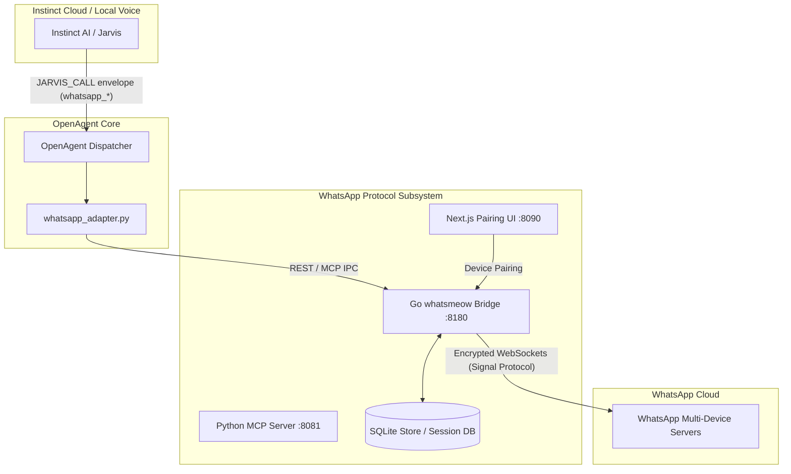

# 📱 Native WhatsApp Protocol Engine (`whatsapp-mcp-extended`)

OpenAgent natively integrates the **`whatsapp-mcp-extended`** engine—a pure protocol-level multi-device bridge built on Go ([`whatsmeow`](https://github.com/tulir/whatsmeow)) and the Model Context Protocol (MCP). It gives your external intelligence (Jarvis / Instinct AI) full sovereign capability to operate your personal WhatsApp account directly from your Mac without touching the desktop GUI.

---

## 💡 Why Protocol-Level WhatsApp Control?

Most AI assistants interact with desktop apps using fragile GUI automation: clicking screen coordinates, taking screenshots, or simulating keystrokes. This approach has fatal flaws:
- It steals your mouse cursor and keyboard focus.
- It fails when windows are occluded, minimized, or when you are gaming or coding in fullscreen.
- It is slow, error-prone, and visually disruptive.

The **Native WhatsApp Protocol Engine** solves this completely:
1. **Zero GUI Overhead & Ghost Mode**: Dispatches actions directly over end-to-end encrypted WebSockets via the WhatsApp Web Multi-Device protocol.
2. **Instant Execution**: Messages, voice notes, polls, and media are transmitted in milliseconds directly to WhatsApp servers.
3. **100% Background Execution**: Jarvis can read incoming messages, reply to contacts, send PDFs, and react to group chats while you play fullscreen Metal games or work in your editor without a single pixel moving.
4. **Official Multi-Device Companion**: Operates as a legitimate linked companion device (like WhatsApp Web or iPad), fully compliant with Signal Protocol end-to-end encryption.

---

## 🏗️ Architecture



### Components:
1. **Go Protocol Bridge (`whatsapp-bridge`)**: High-performance Go daemon running `whatsmeow`. Manages multi-device cryptographic handshakes, presence simulation, anti-ban rate limiting, media encryption/decryption, and provides a REST API on `http://localhost:8180`.
2. **Python MCP Server (`whatsapp-mcp-server`)**: Model Context Protocol service on `http://localhost:8081` exposing tools to LLMs and agent harnesses.
3. **Next.js Web UI (`whatsapp-web-ui`)**: Clean web dashboard on `http://localhost:8090` for one-click pairing, webhook inspection, and session diagnostics.
4. **OpenAgent Adapter (`whatsapp_adapter.py`)**: Native Python dispatcher translating Jarvis commands into fast bridge calls with structured error handling.

---

## 🛠️ The 14 Native WhatsApp Tools

Instinct AI has direct access to 14 native protocol tools:

| Category | Tool | Description |
| :--- | :--- | :--- |
| **Messaging** | `whatsapp_send` | Send text messages with quoting (`quoted_message_id`) and group `@mentions` |
| | `whatsapp_read` | Search historical messages across all chats or read thread history |
| | `whatsapp_chats` | List all active conversations, group threads, and unread counts |
| **Media & Audio** | `whatsapp_file` | Send files, images, PDFs, and documents headlessly without desktop GUI |
| | `whatsapp_audio` | Send native audio recordings and official voice notes (`.m4a`, `.ogg`, `.wav`) |
| **Interactivity** | `whatsapp_reaction` | React to any WhatsApp message with emojis (`👍`, `❤️`, `🔥`) |
| | `whatsapp_edit` | Edit previously sent message text |
| | `whatsapp_delete` | Revoke / delete messages for everyone in the chat |
| | `whatsapp_poll` | Create multi-choice interactive polls in individual chats or groups |
| **Contacts & CRM** | `whatsapp_contacts` | Fast contact search by name, push name, or phone number |
| | `whatsapp_contact_context` | Full contact historical thread and CRM interaction metrics |
| **Administration** | `whatsapp_group` | Group administration (create groups, add/remove members, promote admins) |
| | `whatsapp_presence` | Set presence state (`available`, `unavailable`, `composing`, `recording`) |
| | `whatsapp_status` | Inspect protocol engine health, bridge latency, and multi-device session state |

---

## 🚀 One-Time Setup & Device Linking

### Step 1: Start the Protocol Subsystem
Run `boot.py` with the WhatsApp MCP flag:
```bash
./boot.py --start-whatsapp-mcp
```
OpenAgent checks container health and boots both the Go bridge (`http://localhost:8180`) and Web UI (`http://localhost:8090`).

### Step 2: Link Your Account
You have two pairing methods:

#### Method A: 8-Digit Phone Pairing Code (Recommended — No QR Needed)
1. Open **[http://localhost:8090](http://localhost:8090)** in your browser.
2. Enter your phone number with country code (e.g. `919876543210` for India or `16508702892` for USA, without `+` or spaces).
3. Click **Generate Code** to view your 8-digit code.
4. On your phone:
   - Open **WhatsApp** → **Settings** (or 3 dots) → **Linked Devices** → **Link a Device**.
   - Tap **Link with phone number instead** at the bottom.
   - Enter the 8-character code shown on screen.

#### Method B: Live ASCII QR Scan
If you prefer scanning a QR code:
```bash
docker logs -f whatsapp-mcp-whatsapp-bridge-1
```
Open **WhatsApp > Linked Devices > Link a Device** and point your camera at the ASCII QR code printed in the terminal.

### Step 3: Verify Connection
Check live status:
```bash
curl -s http://localhost:8180/api/connection
# Expected output:
# {"success":true,"connected":true,"linked":true,"needs_pairing":false,"jid":"<your_number>@s.whatsapp.net","uptime":"..."}
```

---

## 🔒 Session Reliability & Anti-Ban Protection

WhatsApp has strict anti-automation heuristics. `whatsapp-mcp-extended` incorporates enterprise-grade protection:

1. **Persistent Session Storage**:
   All cryptographic identity keys, pre-keys, and connection tokens are stored in `src/tools/whatsapp-mcp/data/whatsapp-bridge.db`. Once linked, your session survives Mac reboots, Docker restarts, and system updates without re-scanning.
2. **Anti-Ban Interceptor & Warmup**:
   Limits message frequency using an exponential warmup curve for newly paired devices, avoiding burst-rate triggers.
3. **Humanized Presence Linger**:
   Simulates human client behavior by sending presence updates (`composing`, `paused`) with randomized jitter before dispatching messages.
4. **Fault Recovery & State Unlocking**:
   - Extended 15-minute multi-device handshake window preventing timeout disconnects.
   - Automatic 165-second auto-expiry clearing stale pairing locks.
   - Manual recovery endpoint: `curl -s -X POST http://localhost:8180/api/pair/reset`.

---

## 💬 Example Voice Commands for Jarvis

Once paired, you can speak naturally to Jarvis:

- *"Jarvis, message Sarah on WhatsApp that our meeting is pushed by 15 minutes."*
- *"Check my WhatsApp messages from Alex."*
- *"Send the audit PDF in my reports folder to the Core Engineering group on WhatsApp."*
- *"React with a thumbs up to the last message from David."*
- *"Create a poll in the Weekend Trip group asking: Pizza or Sushi?"*
- *"What are my unread WhatsApp chats right now?"*
